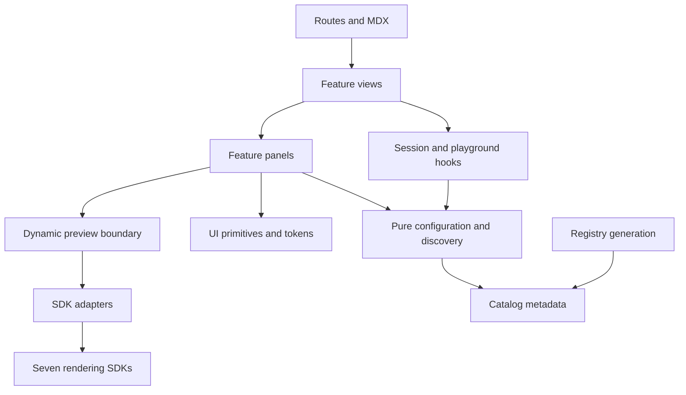

# Architecture

Liven UI is a Bun/Turborepo monorepo with one Next.js application, seven rendering SDKs, a small UI foundation, a registry installer and shared compiler configuration. Its purpose is a developer component library. User journey: discover → preview → configure → integrate. Read [the operating contract](../AGENTS.md) and [design guide](../design.md) before changing boundaries.

## Workspace topology

```text
apps/docs/
  app/                         routes, providers and Glass shell
  features/component-library/
    index.ts                   public feature exports consumed by routes/MDX
    data/catalog.json          API metadata and package identity
    lib/                       pure configuration, discovery and example logic
    hooks/                     browser session and playground state
    views/                     collection, gallery and workbench composition
    components/                panels and composable UI
    previews/                  seven dynamic SDK adapters
    styles/                    owner-scoped presentation rules
  content/docs/agents/         public MDX guides and canonical page tree
  scripts/                     registry, documentation and search generation
packages/
  agent-ui/                    native Button/Select and semantic tokens
  border-beam/                 border effect SDK
  thinking-orbs/               orb React and engine APIs
  metal-fx/                    material React and engine APIs
  liquid-gooey/                liquid React and engine APIs
  voice-glow/                  voice React and engine APIs
  img-fx/                     image React and engine APIs
  bot-avatars/                 avatar React and engine APIs
  cli/                         livenui-cli installer and registry build APIs
  ui/                          existing installer/documentation support
  tsconfig/                    shared compiler contracts
scripts/check-architecture.ts  dependency and documentation boundary gate
tests/                        domain, SDK and registry contracts
e2e/                          browser journeys and measurable design contracts
```

There are 12 workspaces. The private application is `@livenui/docs`; shared controls use `@livenui/agent-ui`, and installer support uses `livenui-cli` and `livenui-ui`. Seven rendering SDKs retain their runtime identities. Registry adapters, CLI resolution and consumers depend on these names, so future renames must update manifests, imports, scripts and tests together.

## Dependency direction



`lib/` imports only domain code and data at runtime. Hooks do not import presentation. Panels receive session state and may import hook types, but do not create another independent playground session. Runtime SDK imports belong in `previews/`; this keeps scene dependencies lazy. `agent-ui` depends on React only, never app code or effect SDKs. Workspace packages cannot depend on applications; workspace cycles are errors. These rules are enforced by `bun run check:architecture` using parsed TypeScript imports and manifests.

## Source of truth

| Concern | Canonical owner | Derived consumers |
| --- | --- | --- |
| Package identity, versions, variant APIs and field metadata | Feature `data/catalog.json` | Config types, API tables, installer registry |
| Defaults, parsing, snippets and agent prompts | Feature `lib/config.ts` | Controls, JSON transfer, integration code, contract tests |
| Structured JSON prop schemas | Feature `lib/structured-props.ts`, called by `lib/config.ts` | Imports, presets, Studio handoffs and nested Liquid.Item tuning |
| Discovery copy, essential settings, search and commands | Feature `lib/content.ts` | Overview, gallery, controls, installer commands |
| Complete example configurations and stable IDs | Feature `lib/examples.ts` | Gallery, starting points, Studio deep links |
| Featured example IDs, human control labels and explicit quick choices | Feature `lib/content.ts` | Guide showcases and control panels |
| Documentation navigation | `content/docs/agents/meta.json` through `lib/source.ts` | Glass sidebar, route metadata |
| Semantic geometry/type/emphasis | `packages/agent-ui/src/tokens.css` | Feature style files and browser contracts |
| Website mark geometry | `apps/docs/public/logo.svg` | Token-filled shell mask, generated icons and locally embedded sharing artwork; see [brand ownership](brand.md) |
| Render implementation and public exports | Each SDK's `src/` and manifest | Built ESM/CJS/types, adapters and consumers |

Catalog metadata is checked in and curated; it is **not automatically extracted from SDK types**. When SDK APIs change, update metadata, defaults, snippets, examples and guides together. Domain/registry tests detect configuration drift but do not prove every metadata description is accurate.

## State and lifecycle

`useLibrarySession` owns the resolved app theme, router navigation and `livenui-presets` local storage. `usePlayground` owns props, variant, tabs, drafts, preview playback, validation notices and transfer actions. Controls, preview and integration consume the same state instance, so the code reflects the displayed configuration. Controls, JSON snapshots and saved presets use the effective playback props. Beam/Voice activation follows `active`; Voice retains its independent native `paused` freeze setting. Replacing a configuration or Metal variant updates the draft; ordinary toolbar actions preserve unfinished edits.

Studio `library` and `example` query parameters initialize a keyed workbench; invalid selections fall back safely. Gallery `library` and `q` filters use native history integrated with the router. Typing replaces the current history entry; explicit filter selections push one. Results load 12 at a time while preserving all 87 examples and representing all seven libraries in the first batch.

The source loader attaches server-rendered decorative icons from [navigation-icon.tsx](../apps/docs/lib/navigation-icon.tsx) to existing page-tree destinations after normalizing the Studio URL. Glass retains link rendering, active-route ownership and drawer behavior. Shell [navigation.css](../apps/docs/app/navigation.css) owns finite icon motion; no additional client state, animation dependency or SDK scene is created.

The workbench owns the Preview / Install & Usage task switch while retaining one `usePlayground` instance. Inactive task contents unmount, releasing their preview scenes and microphone state. Switching back recreates the preview with retained props/playback and requires an explicit new microphone request. Guides use a small showcase and quick settings; Studio adds full controls, Saved and JSON views. Both reuse the same code panel and integration composition.

Guide-to-Studio handoff uses a validated configuration in the URL fragment, with `library` in the existing query parameter. The client reads the fragment on initial navigation, reload and native hash/history events; the serialized props are not sent as a server query. `parseConfiguration` validates both imported files and handoff envelopes against the selected component variant. Raw props remain supported, including Metal's shape `variant` prop, which is distinct from an envelope's component variant. Invalid handoffs report a notice and preserve safe defaults. Oversized or nonserializable application references require integration through code instead of a Studio link.

`Preview` imports adapters dynamically with SSR disabled. `PreviewBoundary` catches render errors. Replay remounts only this boundary. Cards use IntersectionObserver and pause offscreen previews; example cards release their mounted scenes offscreen. Reduced motion initially pauses effects. Renderers, animation frames, observers and microphone tracks must be released by their owners on teardown. Image cycle callbacks belong to their reveal generation; stale loading, completion and failure callbacks cannot mutate a replacement cycle. Avatar global listeners exist only while ticker subscribers remain.

Metal shares a renderer but maintains per-instance material frames and pause behavior. Preserve paused initial-frame rendering, instance preset isolation and context-loss identity guards. Liquid supports morph, move, melt and bend; avatars retain native materials, gaze and state interactions. Do not substitute screenshots or CSS imitations for SDK effects.

Image cycle startup retains an explicit pause without scheduling image work. Resuming a cycle preserves its one-shot or continuous mode and manual hold. Completing a resumed hide releases the current image and schedules another reveal only for continuous playback.

Explicit paused Image draws include the target's dimensions when sizing the shared renderer, and paused resizes repaint the held reveal. Resetting a shader after the final instance is destroyed must not allocate another renderer. Voice's frame loop sleeps once every registered instance has painted its paused configuration; registering a changed or active instance wakes it. Custom avatar material caches use complete path identity rather than a reduced animation seed.

## Data and trust boundaries

JSON configuration is untrusted input. Parsing rejects unknown props, non-finite numbers, unsupported variants, prototype keys, invalid structures and excessive depth/key counts. Files are limited to 64 KB and must match the selected library. Never evaluate uploaded configuration, functions or arbitrary module strings. Function/element props belong in application code.

Structured validators follow the selected SDK component's JSON-compatible unions, required object fields and tuple lengths. Voice color arrays contain strings; Image color arrays also allow null entries. CSS avatar sizes remain strings or numbers. Application references, including Metal masks, cannot be imported as JSON. SDK API changes must update these schemas alongside catalog metadata.

Only the current file import may replace configuration or report a result. A newer import, draft edit, applied configuration, field edit, preset/example load, Reset, variant selection, playback action or unmount invalidates pending reads. Capture the selected file and clear the input before reading so the same file can be selected again. Invalidating a read prevents state updates; it does not cancel the browser's file operation.

Presets stay in this browser; unavailable or corrupt storage is handled without crashing. Exported JSON includes library, component, variant and effective playback props, plus theme only when the selected API supports it. Files and shared fragments are limited to 64 KB measured as UTF-8. Microphone access is click-initiated and local. Pending capture requests are shared and invalidated on stop or unmount; late streams are stopped before they can become live. Hosted accounts, billing, cloud presets and agent chat are not connected.

## Build and compatibility contracts

Bun 1.4.2 is pinned in the root manifest. Use Node 24. Turbo builds upstream workspace packages before app typecheck/build. SDKs emit ESM, CJS, declarations and source maps with tsup and the TypeScript 6 compatibility compiler; the application uses TypeScript 7. Keep this split until a measured migration proves declaration and bundler compatibility.

Next's pre-build regenerates both source registry formats with clean output directories. `components/registry.mts` maps public component IDs to the local SDK directories. `scripts/build-registry.ts` packages the full source tree, a client entry, LICENSE and available NOTICE files; it never replaces local changes with a published upstream SDK. MDX generation owns `.source/`; Next owns `.next/`; tsup owns `dist/`. Edit source adapters, never generated output. Search is local by default; optional remote synchronization requires `LIVENUI_SYNC_SEARCH=1` and existing credentials. Do not introduce network side effects to ordinary validation.

Post-build task failures propagate a nonzero process exit. Optional search synchronization cannot report a successful build after a requested sync fails.

Protected public contracts include `/agents`, `/agents/gallery`, `/studio`, seven `/agents/{id}` guides, `/agents/integration`, `/api/search`, `/r`, `/registry`, `/agent-skill.md`, `/llms.txt`, `/llms-full.txt`, MDX text, static JSON and OG routes. `/` and retired blog routes retain redirects. Glass page-tree navigation has one active destination. The site origin is owned by `lib/site.ts` with a shared production fallback in the pure distribution helper, using `NEXT_PUBLIC_APP_URL` or a localhost default until a hosted origin is configured. Metadata and registry generation share this origin; do not advertise retired RSS endpoints. Infrastructure in `nixpacks.toml`, Turbo outputs, root scripts and `.github` remains explicit and reviewed.

The seven SDK workspaces remain private internal build identities. Public installation uses the source registry IDs, not those npm package names. Payloads include full local TypeScript source and legal files; runtime dependencies are limited to retained implementation dependencies such as Three.js and the Metal shader package. Image includes Three.js types. Both registry formats retain legacy endpoint aliases without adding upstream effect dependencies. Standard registry targets use `@components/livenui` to respect the consumer's component-directory configuration; generated code assumes `@/components/livenui` and documents alias adjustment.

The registry distributes a maintained fork, not a claim of original authorship. See [Decision 002](decisions/002-source-registry-distribution.md). Local generation has been verified; publication of npm packages or deployment of registry updates requires separate authorization.

## Documentation audiences

Root guides and `docs/` instruct coding agents maintaining this repository. Public MDX and `public/agent-skill.md` instruct developers/agents integrating components into another app. Keep these audiences separate: public pages do not need internal commit policies, absolute workstation paths or maintenance diagnostics.

Architectural research and adaptation rationale are in [the decision record](decisions/001-component-library-foundation.md). Historical audits remain under `reports/` with their original dates and limits.
